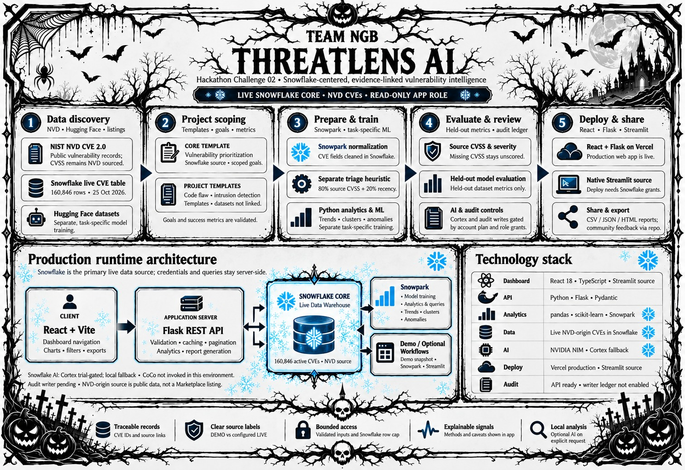

# ThreatLens AI · Team Nova cybersecurity platform architecture

## What the diagram represents

ThreatLens AI is Team Nova's flagship open-source cybersecurity implementation. The diagram follows the running repository and current production configuration: the React dashboard calls a Flask REST API, which reads the canonical NVD-origin CVE table in Snowflake. The native Streamlit entry point uses an authenticated Snowpark session for in-warehouse normalization and triage. A bundled NVD snapshot remains available as a labeled demo source. The backend exposes discovery, scope-validation, paginated vulnerability, report, trend, ML, and audit endpoints. CSV, JSON, and HTML reports are generated by the application.

The local Snowflake path is account-verified. It reads the canonical `THREATLENS_DB.THREATLENS.VULNERABILITIES` table, populated with NVD 2024–2026 CVE feeds. The application role is read-only and the query is row-bounded. Optional Snowpark transforms operate in-warehouse when invoked by a Snowpark session; `AI_COMPLETE` sends a bounded public-data summary to the configured account and falls back to local deterministic analysis if unavailable. Direct verification found `AI_COMPLETE` is not enabled for this account's trial, so generated Cortex results are not claimed as live. Snowpark and Cortex use depend on package installation, role privileges, model availability, region, and account limits. The source is NVD-origin data stored in Snowflake, not a Marketplace listing; the discovery catalog lists Marketplace and shared sample data as account-dependent discovery targets and does not claim they are installed.

The optional Hugging Face import/training workflow is a separate offline task-model path; those supervised models are not silently trained on the active Snowflake table. Project templates scope dataset, goal, and metrics in browser-local storage. An optional append-only Snowflake audit ledger records contribution, peer-review, and held-out evaluation events using a separately configured writer identity and server-only write token; contribution points use fixed event-type weights (code 5, documentation 2, dataset 4, model 6, peer review 3, other 1) and are not identity verification or objective quality claims. Local statistical analysis works without an AI key. NVIDIA NIM, Kimi, DeepSeek, or Snowflake Cortex commentary is an explicit, optional request that sends bounded analysis context to the selected provider. Snowflake credentials and AI keys stay in server environment variables.

CoCo usage and shared resource allocation are not represented as runtime capabilities. No CoCo use is claimed; see [docs/coco-workflow.md](coco-workflow.md). The separately documented Snowpark and Streamlit paths require the optional requirements file and Snowflake configuration.

## Blueprint stages

1. **Discover:** `GET /api/project-catalog` and `GET /api/datasets` expose a curated NVD, Hugging Face, Snowflake sample-schema, and Marketplace discovery catalog. Account-dependent sources are clearly labeled.
2. **Scope:** `POST /api/project-scopes` validates the selected template, datasets, goal, and success metrics. The UI saves the validated scope in browser storage; it does not silently allocate compute.
3. **Prepare and train:** the optional Snowpark transform cleans canonical CVE fields and computes a separately named triage heuristic in Snowflake. Existing Hugging Face training remains task-specific and uses held-out evaluation.
4. **Evaluate and review:** `GET/POST /api/contributions` reads or appends audit events when the dedicated audit table, identity, grants, and write token are configured. `GET /api/ml/training` supplies held-out task metrics.
5. **Deploy and feedback:** the React/Flask app remains the primary web application; `streamlit_app.py` is an additional Snowflake Streamlit entry point. Deployment still requires environment configuration and platform setup.

## Shareable asset

The [architecture PNG](architecture.png) is the supplied Team NGB diagram. The [SVG preview](architecture.svg) embeds the same image for README and browser rendering.
