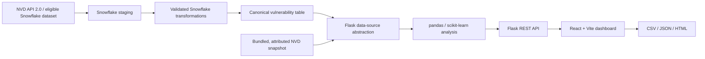

# Architecture

Snowflake CoCo may assist humans exploring the source and iterating on SQL, but it is not a runtime dependency or data source. Demo mode reads the bundled snapshot. Live mode requires configured Snowflake access and a real canonical table; API health only reports live after source access succeeds. The frontend never receives Snowflake credentials.
