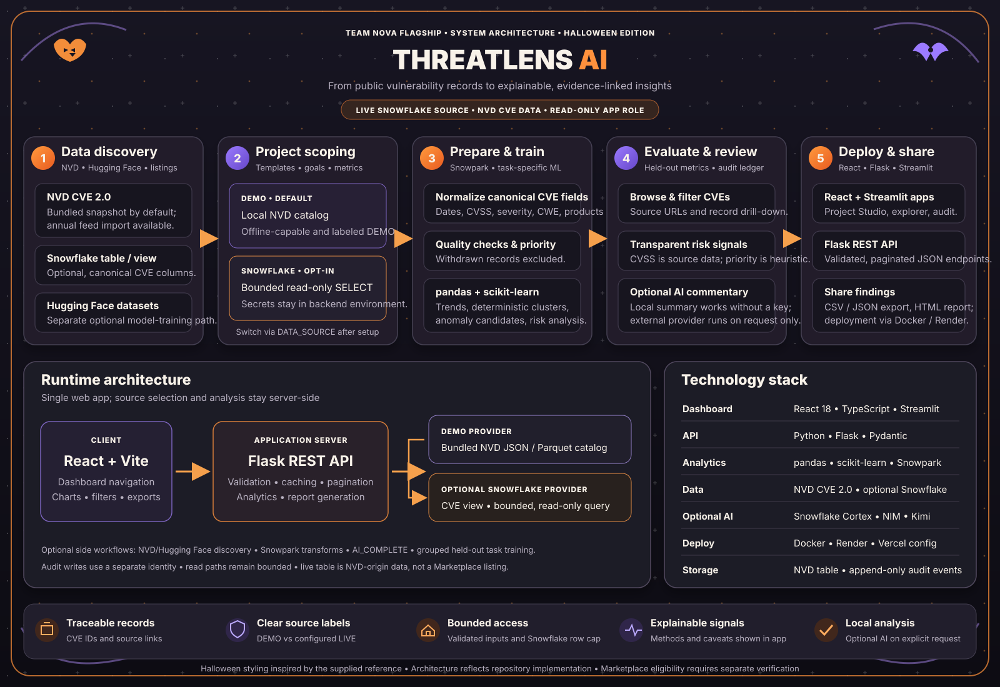

# ThreatLens AI system architecture

## What the diagram represents

The diagram follows the running repository. The React dashboard calls a Flask REST API. Flask selects either the bundled NVD demo catalog or, when configured, a canonical CVE table/view in Snowflake. The backend normalizes records, calculates transparent priority scores and analytics, and exposes paginated, filtered, report, trend, and ML endpoints. CSV, JSON, and HTML reports are generated by the application.

The local Snowflake path is account-verified. It reads the canonical `THREATLENS_DB.THREATLENS.VULNERABILITIES` table, populated with NVD 2024–2026 CVE feeds. The application role is read-only and the query is row-bounded. The source is NVD-origin data stored in Snowflake, not a Marketplace listing; any event's Marketplace eligibility must be assessed separately. See [snowflake/setup.md](../snowflake/setup.md) for connection details and limits.

The optional Hugging Face import/training workflow is a separate offline task-model path; those supervised models are not silently trained on the active Snowflake table. Local statistical analysis works without an AI key. NVIDIA NIM, Kimi, or DeepSeek commentary is an explicit, optional request that sends bounded analysis context to the selected provider. Snowflake credentials and AI keys stay in the backend environment.

CoCo, mentor review, contribution scoring, shared resource allocation, and deployment to Streamlit are not implemented runtime capabilities and are not represented as such. No CoCo use is claimed; see [docs/coco-workflow.md](coco-workflow.md).

## Shareable asset

The self-contained, vector diagram is [architecture.svg](architecture.svg). It can be opened in a browser or imported into a presentation. The Halloween styling follows the supplied reference while the labels and flows are grounded in this repository.
